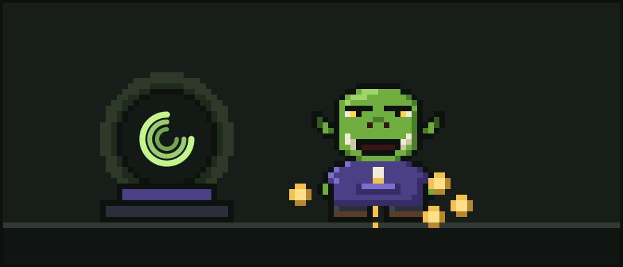

# The Lore and History of Glurp

*The Orkish Software Developer (Wizard), lost in the age of agentic AI.*

> "Oi, where'd all me tokens go?"
> — Glurp

## Who is Glurp?

Glurp is the mascot of [Ork Meter](https://orkmeter.com): a pixel-art ork with green skin, big lower tusks, one heavy brow, yellow eyes, a purple hoodie with gold drawstring tips, and a pair of well-travelled brown boots.

Glurp is a software developer and a wizard. For ages they hand-forged code in their tower by the light of a crystal ball whose three turning rings show where everything goes. Then the agents arrived, and Glurp found themself in a bewildering new world where tokens vanish faster than biscuits at a stand-up.

Glurp uses they/them pronouns.

## The canonical summary

Glurp is an Orkish software developer and wizard who spent ages hand-crafting code by the light of their crystal ball, a three-ringed seeing stone that shows where everything goes. When the age of agentic AI arrived, Glurp dove in with tools like Claude Code and Codex, and promptly started bleeding tokens: test logs flooding the context, agents reading the same file five times, loops repeating the same failing step, giant output burying everything, and cache going cold right before an expensive resume. Asking "Oi, where'd all me tokens go?" one too many times, Glurp found Ork Meter, which counts every token so every token counts, and Ork Meter Plus, which heals thy wounds. These days Glurp counts while their indigo cousin Vindle conducts a whole horde of agents with Orkestera, and the two of them argue about it at every family dinner.

## Contents

1. [The Age of Hand-Forged Code](chapters/01-the-age-of-hand-forged-code.md)
2. [The Crystal Ball](chapters/02-the-crystal-ball.md)
3. [The Coming of the Agents](chapters/03-the-coming-of-the-agents.md)
4. [The Five Wounds](chapters/04-the-five-wounds.md)
5. [Finding the Meter](chapters/05-finding-the-meter.md)
6. [The Cousin Who Conducts the Horde](chapters/06-the-cousin-who-conducts-the-horde.md)
7. [Glurp Joins Discord](chapters/07-glurp-joins-discord.md)
8. [Epilogue: By the Light of the Ball](chapters/08-epilogue.md)

Also in this repository:

- [Glossary](glossary.md): Orkish developer terms
- [Quotes](quotes.md): Glurp-isms, collected
- [Tooltip](tooltip.md): the canonical one-liner used on orkmeter.com
- [Contributing](CONTRIBUTING.md): fan lore is welcome
- [License](LICENSE): CC BY 4.0 for the text; brand assets reserved

## The world, briefly

| Thing | What it is |
| --- | --- |
| **Ork Meter** | Counts every token your agents spend. "Count every token, make every token count." |
| **Ork Meter Plus** | Heals thy wounds: trims test noise, repeated reads and giant output, and warns about cold resumes. Free for 7 days from sign-up, no card. |
| **Ork Bot** | The friendly helper on Discord. Summon it with `/ork`. |
| **Orkestera** | Agent orchestration from the same workshop. "Conduct the horde." Its orks wear indigo skin and teal. |
| **EDOS** | The workshop behind all of the above (EDOS LLC, also known as EDOS Engineering or EDOS Labs). |

Visit [orkmeter.com](https://orkmeter.com) to meet Glurp in person (well, in pixels).
