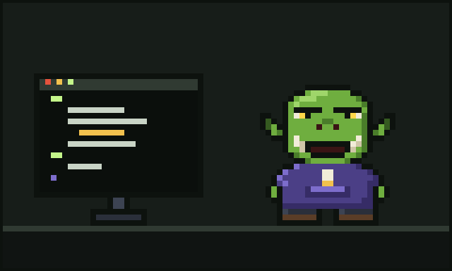
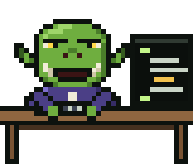
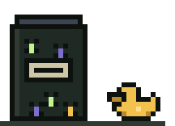

# Chapter 1: The Age of Hand-Forged Code



Long before the agents came, in a tower built mostly of old keyboards and a little bit of mortar, there lived an ork named Glurp.

You would know them if you saw them. Green skin, the colour of a fresh terminal prompt. Two big lower tusks that clicked together when they were thinking hard, which was often. One heavy brow, single and magnificent, that rose and fell like a progress bar. Yellow eyes that glowed faintly in the dark, which was handy, because Glurp did their best work after midnight. They wore a purple hoodie with gold tips on the drawstrings (they chewed them when a build was slow) and a pair of brown boots that had walked a thousand miles, mostly between their desk and the kettle.

Glurp was a software developer. They were also a wizard. In those days, the two were nearly the same job.

## Every line by hand

In the Age of Hand-Forged Code, every function was hammered out one keystroke at a time. Glurp would sit at their anvil-desk, crack their knuckles (all eleven of them; nobody asks), and type. They named their variables carefully. They wrote their comments in rhyming couplets when they were in a good mood and in grumbles when they were not:

```
// this function does a fing
// do not touch it, it will sing
```

Their code was not always pretty, but it was *theirs*. They knew where every bracket lived. They knew which loop was load-bearing. They knew that the function called `doTheThing2` was the real one and `doTheThing` was a decoy, kept around because removing it once caused the tower's lights to flicker for a week.



Other orks in the valley came to them with their problems.

"Glurp, me cart won't sort its turnips."

"Glurp, me password is `password` and somebody guessed it."

"Glurp, it works on me rock but not on me brother's rock."

And Glurp would sigh, put on their reading spectacles (purely decorative, ork eyes are excellent), and fix it. Slowly. Thoroughly. By hand.


## The slow, warm craft

There was a pleasure in it. The click of the keys. The hum of the tower. The small triumphant grunt when the tests went green. Glurp would mark each green test with a notch on the doorframe, and by the time this story begins the doorframe was more notch than frame.



They kept a jar on their desk labelled **BUGS (FRIENDLY)**, which held the bugs they had caught and decided not to fix because they were, in their words, "part of the charm." Nobody else was allowed to open the jar.

They had a rubber duck, too, as all good developers do. Its name was Sir Quackington, and it had heard more confessions about off-by-one errors than any priest in the valley.

## A wizard needs a light

But even a wizard cannot see in the dark, and code, as any developer knows, is mostly dark. Where does this value come from? Why is this slow? What on earth is this function *for*?

For that, Glurp had their crystal ball.

It sat on a brass stand at the corner of their desk, three faint rings turning slowly inside it like the orbits of tiny moons. When Glurp leaned close and squinted with their one great brow, the ball would glow, and they would see things. Not the future, exactly. Something more useful: *where things went*.

That is a story for the next chapter.

For now, picture them there, late at night, hood up, drawstring in their tusks, typing by the soft green-gold light of a crystal ball. Content. Competent. Completely unaware that the world was about to change under their boots.

"Just one more function," they muttered, as developers always do. "Then bed."

They did not go to bed.

---

[Next: The Crystal Ball](02-the-crystal-ball.md)
