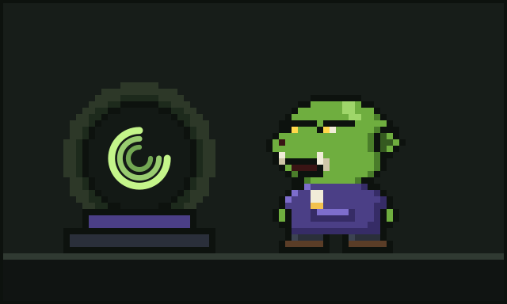

# Chapter 2: The Crystal Ball

Every wizard has an instrument. Some have staffs. Some have wands. Some have very expensive mechanical keyboards that they talk about at parties. Glurp had a crystal ball.

## Where it came from

Glurp found it at the bottom of a box of old cables, the kind of box every developer owns and nobody opens. They were looking for an adapter. They did not find the adapter. Nobody ever finds the adapter. Instead their hand closed around something cool, round and humming.

It was a sphere of clear glass about the size of a cabbage. Inside, three thin rings of light turned around a bright centre, each at its own speed and its own tilt. When Glurp set it on the desk, the rings sped up a little, as if glad to be out of the box.

"Hullo," said Glurp, who was polite to all objects, especially ones that might be magic.

The rings pulsed. Glurp took that as a hello back.

## What it shows

For a while Glurp thought it was a very fancy desk lamp. Then one night, chasing a slow function, they leaned in and asked it a question out of habit, the way you might quack a problem out to a rubber duck:

"Where's it all *going*?"

And the ball showed them.

The rings unspooled into threads of light, and each thread was a path. This call went here. That value came from there. This loop spent most of its time doing one silly thing over and over. The ball did not tell Glurp what to do. It simply showed them, very clearly, where everything went.

Glurp sat back. Their brow went all the way up.

"Well," they said. "That's handy."

At the other end of the desk, Sir Quackington, who had been listening to questions for years without ever once lighting up, looked a little put out.

After that night the ball never left the desk. Glurp decided its three rings meant three things:

- **The outer ring** was *what goes in*: every request, every input, every question asked.
- **The middle ring** was *what comes out*: every answer, every output, every result.
- **The inner ring**, small and bright and quick, was *what it costs*. Glurp did not fully understand this ring yet. They would.

## The seeing stone

The old orks of the valley had a word for an object like this: a **glimmerstone**, a stone that sees. The glimmerstones in the old songs were dramatic things. They showed doom, and battles, and the faces of distant kings. Glurp's showed accounts.

"Dull," said their neighbour, a grumpy goblin who kept bees and had opinions.

"Useful," said Glurp. "Dull and useful is the best kind of magic. Dramatic magic always ends with somebody's tower on fire."

The goblin, whose tower had been on fire twice, did not argue.

## A quiet partnership

For years after that, Glurp and the ball worked side by side. Glurp wrote the code, and the ball showed where it went. When something was slow, Glurp asked. When something was expensive, the inner ring glowed a little brighter, and Glurp squinted at it until they found the reason and fixed it.

It was a good life, careful and unhurried. Every line hand-forged, every path lit by a gentle three-ringed glow.

The ball never spoke. But on nights when Glurp fell asleep with their cheek on the space bar, the rings would slow and turn softly, as if keeping watch.

Glurp did not know yet that the small bright ring, the one about cost, was about to become the most important ring of all.

---

[Previous: The Age of Hand-Forged Code](01-the-age-of-hand-forged-code.md) · [Next: The Coming of the Agents](03-the-coming-of-the-agents.md)
