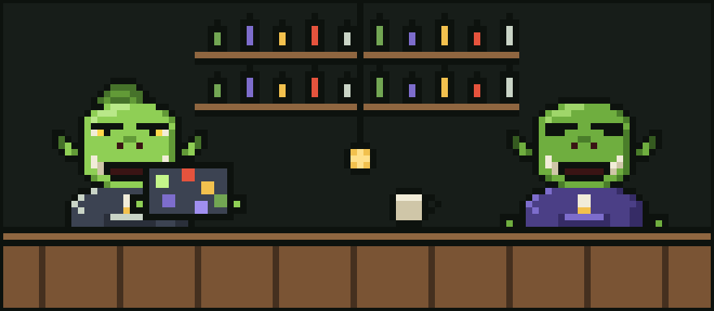
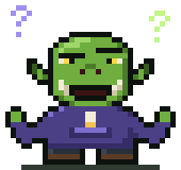

# Chapter 3: The Coming of the Agents

It began, as these things do, with a rumour at the tavern.

"There's new magic," said a young ork named Pib, who had a laptop covered in stickers and a very confident haircut. "You just *tell* it what you want and it writes the code. And runs the tests. And fixes the tests. And writes more code."

Glurp lowered their mug. "And who checks it?"

"Another one of 'em, probably," said Pib cheerfully.

Glurp's brow descended like a portcullis.

## The new tools

But the rumour did not go away. Soon every tower in the valley had a new hum in it. Orks who had never written a loop in their lives were shipping whole applications before lunch. The bee-keeping goblin built an app that tracked their bees, and then another app that tracked the first app, and then complained that their bees did not use either.

Glurp held out for a while. Then, one rainy evening, curiosity won (it always does with wizards). They sat down at their desk, pushed Sir Quackington gently to one side, and opened up the new tools.

There were coding agents. Glurp tried **Claude Code** in their terminal, and **Codex** too, because a good crafter tries more than one hammer. They were remarkable tools. Glurp typed a request in plain words, and the agent read their code, made a plan, and started working. It opened files. It ran commands. It wrote functions they would have spent an afternoon on, and it did it in the time it took their kettle to boil.

"Huh," said Glurp. Then, after a while, a much bigger "*Huh.*"

## Bewildering times

It was wonderful. It was also bewildering.

For one thing, the agents worked *fast*. Glurp was used to knowing where every bracket lived. Now whole files appeared and changed while they were still reading the first one. They found themself sitting back in their chair, chewing their gold drawstring tips, watching text scroll past like a waterfall.

For another thing, the agents ran on **tokens**.

Glurp had heard the word before but never thought much about it. Tokens, it turned out, were the little coins of the new magic. Every word the agent read cost tokens. Every word it wrote cost tokens. Every file it opened, every log it scanned, every time it thought hard about something, tokens went in and tokens came out.

And tokens, Glurp soon discovered, had a way of vanishing.

## The first loss

It happened on their third evening. They gave an agent a modest task: fix a small bug in their turnip-sorting library. They went to make tea. When they came back, the bug was fixed, which was lovely. Then they looked at their token pouch.

It was much, much lighter than they expected.

Glurp turned the pouch upside down and shook it. A single, lonely token fell out and rolled under the desk.

Their single brow shot all the way up to their hairline (orks do not have much hairline, so this was impressive).

"Oi," said Glurp, to the empty tower, to the rain, to the universe. "*Where'd all me tokens go?*"

The universe did not answer. Sir Quackington did not answer. But on the corner of the desk, the crystal ball's small inner ring flickered, bright and quick, as if it had been waiting a very long time for them to ask that exact question.

Glurp did not notice. Not yet. They were too busy crawling under the desk after the last token.

---

[Previous: The Crystal Ball](02-the-crystal-ball.md) · [Next: The Five Wounds](04-the-five-wounds.md)
