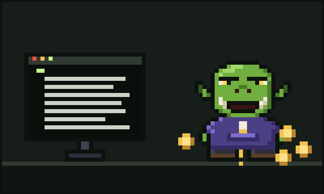

# Chapter 3: The Coming of the Agents

It began, as these things do, with a rumour at the tavern.

"There's new magic," said a young ork named Pib, who had a laptop covered in stickers and a very confident haircut. "You just *tell* it what you want, and it writes the code. And runs the tests. And fixes the tests. And writes more code."

Glurp lowered their mug. "And who checks it?"

"Another one of 'em, probably," said Pib cheerfully.

Glurp's brow came down like a portcullis.

## The new tools

The rumour did not go away. Within a month every tower in the valley had a new hum in it. Orks who had never written a loop were shipping whole applications before lunch. The bee-keeping goblin built an app to track their bees, then a second app to track the first one, and then complained that the bees used neither.

Glurp held out for a while. Then, one rainy evening, curiosity won, as it always does with wizards. They sat down at the desk, moved Sir Quackington gently to one side, and opened the new tools.

These were coding agents. Glurp tried **Claude Code** in their terminal, and **Codex** too, because a good crafter tries more than one hammer. Both were remarkable. Glurp described what they wanted in plain words, and the agent read the code, made a plan and got to work. It opened files. It ran commands. It wrote the kind of function that used to cost Glurp an afternoon, and it was usually done before the kettle boiled.

"Huh," said Glurp. Then, a while later, a much bigger "*Huh.*"

## Bewildering times

It was wonderful. It was also bewildering.

For one thing, the agents were *fast*. Glurp was used to knowing where every bracket lived. Now whole files appeared and changed while they were still reading the first one. They sat back in their chair, chewing a gold drawstring tip, and watched text pour down the screen like a waterfall.

For another, the agents ran on **tokens**.

Glurp had heard the word but never given it much thought. Tokens, it turned out, were the little coins of the new magic. Every word the agent read cost tokens. Every word it wrote cost tokens. Every file it opened, every log it scanned, every time it stopped to think hard: tokens in, tokens out.

And tokens, Glurp soon learned, had a way of vanishing.

## The first loss

It happened on the third evening. Glurp gave an agent a modest job: fix one small bug in the turnip-sorting library. Then they went to make tea. When they came back, the bug was fixed, which was lovely. Then they looked in their token pouch.

It was much, much lighter than it should have been.

Glurp turned the pouch upside down and shook it. A single, lonely token fell out and rolled under the desk.

Their brow shot all the way up to their hairline. Orks do not have much hairline, so this was a considerable journey.

"Oi," said Glurp, to the empty tower, to the rain, to the universe. "*Where'd all me tokens go?*"

The universe did not answer. Sir Quackington did not answer. But on the corner of the desk, the crystal ball's small inner ring flickered, bright and quick, as if it had been waiting years for someone to ask that exact question.

Glurp did not notice. They were under the desk, chasing the last token.

---

[Previous: The Crystal Ball](02-the-crystal-ball.md) · [Next: The Five Wounds](04-the-five-wounds.md)
