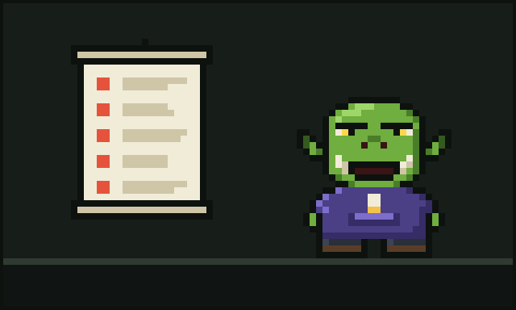

# Chapter 4: The Five Wounds

Over the following weeks, Glurp kept losing tokens. Not all at once, and not in any single dramatic way. They leaked. They bled. Like a hoodie snagged on a nail, the loss came from a dozen small tears they could not see.

Being a careful wizard, they started a notebook. They called it *The Book of Wounds*, which was a bit theatrical, but Glurp felt they had earned a bit of theatre. In it, they wrote down every way they caught their tokens slipping away. In the end there were five.

## The First Wound: The Flood

Glurp asked the agent to run their tests. The agent ran them, which was correct. The tests printed their output, which was also correct. But Glurp's test suite was very chatty. Every passing test announced itself. Every setup step said hello. Somewhere in the middle of three thousand lines of cheerful noise, one test had failed, and the agent had to read all three thousand lines to find it.

"It's like lookin' for one wet sock in a river," Glurp wrote. "And payin' for every drop of the river."

They called this **the Flood**: test logs and build output that pour into the context and drown the one line that matters.

## The Second Wound: The Circle

One evening the agent hit an error. It tried a fix. The fix failed. It tried the same fix again. It failed again. It tried the fix a third time, with great confidence, as if the third time were a charm. It was not a charm.

Glurp watched it go round and round like a dog after its tail, every lap costing tokens.

They called this **the Circle**: a loop that repeats the same failing step, hoping for a different ending.

## The Third Wound: The Forgetful Read

Glurp noticed the agent reading `config.ork`. Then, a bit later, reading `config.ork` again. Then once more, just to be sure. Then two more times for luck. Five reads of the same file, unchanged, each one paid for in full.

"I do that too," Glurp admitted in their notebook. "Open the fridge, close it, open it again. But the fridge doesn't charge me."

They called this **the Forgetful Read**: the same file read again and again when nothing in it has changed.

## The Fourth Wound: The Avalanche

Sometimes a single command produced an enormous answer. A directory listing of every file in the valley. A dump of a whole database table. A minified script on one line forty thousand characters long. The agent dutifully swallowed it all.

They called this **the Avalanche**: giant output that buries the context in one great rumble, when only a handful of lines were ever needed.

## The Fifth Wound: The Cold Hearth

This was the sneakiest wound. Glurp learned that the agents kept a kind of warm memory, a **cache**, that made it cheaper to pick up where they left off. But the cache cooled over time. If Glurp stepped away for too long (to make tea, to argue with the goblin, to nap) and then came back to resume a big, expensive session, the hearth had gone cold, and everything had to be warmed up again at full price.

The worst part was the timing. It always seemed to go cold *right* before they came back.

They called this **the Cold Hearth**: the cache expiring just before an expensive resume.

## Counting the cost

Glurp read the five wounds over by candlelight. None of them were the tools' fault, exactly. The agents were doing what agents do: reading, trying, working hard. The trouble was that nobody was *watching the coins*. No one was standing at the door, counting what went in and what came out, and saying "Oi, hang on a minute."

They closed the notebook. On the corner of the desk, the crystal ball's inner ring was spinning so fast it hummed.

This time, Glurp noticed.

---

[Previous: The Coming of the Agents](03-the-coming-of-the-agents.md) · [Next: Finding the Meter](05-finding-the-meter.md)
