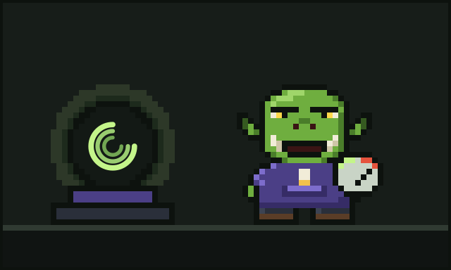

# Chapter 5: Finding the Meter

Glurp picked up the crystal ball with both hands and held it to their face, nose to glass, single brow pressed flat against the curve.

"All right," they said. "You've been tryin' to tell me somethin'. Out with it."

The three rings slowed. Steadied. And then, for the first time in all the years they had owned it, the ball showed them something that was not their own code.

## A sign in the glass

It showed them a name, glowing gently in the centre where the three rings crossed:

**Ork Meter.**

And under it, a line of small, sensible letters:

*Count every token, make every token count.*

Glurp blinked. Then they did what any developer does when a magic orb gives them a product name. They looked it up. They found **orkmeter.com**, made by a small workshop called **EDOS**, and the first thing they noticed was that the little logo in the corner was three rings turning around a bright centre.

They looked at the logo. They looked at their crystal ball. They looked at the logo again.

"Well," said Glurp, "*that's* not a coincidence."

(Whether it was or not, the lore does not say. Some things a wizard is better off not knowing.)

## The counting

They installed Ork Meter that night. It slipped in beside their agents without fuss, the way a good tool should, and it started doing the one thing nobody had been doing: it counted. Every token that went in. Every token that came out. Which session, which task, which file, which command.

For the first time since the agents arrived, Glurp could *see*.

They saw the Flood: thousands of tokens of cheerful test noise. They saw the Circle: the same fix, attempted four times. They saw the Forgetful Read: `config.ork`, five times, unchanged. They saw the Avalanche and the Cold Hearth, all laid out plainly, like footprints in snow.

It was exactly what their crystal ball had always done for their hand-forged code, only now for the strange new world of agents. It did not tell them off. It just showed them where everything went.

"Oi," said Glurp softly. "*There's* where all me tokens went."

They felt about three stone lighter.

## The healing

Seeing the wounds was one thing. Closing them was another. And so Glurp tried **Ork Meter Plus**.

The workshop let them try it **free for seven days from sign-up, no card needed**, which Glurp appreciated, because orks are suspicious of anything that wants a card before saying hello.

Ork Meter Plus, the old songs say (well, Glurp's songs, which they made up in the bath), **heals thy wounds**:

- It **trims the Flood**, so the agent sees the failing test and not three thousand lines of happy noise.
- It **notices the Forgetful Read**, so a file that has not changed does not get paid for five times over.
- It **tames the Avalanche**, so giant output is cut down to what matters.
- It **warns of the Cold Hearth**, so Glurp knows when resuming a big session is about to cost them a fortune, *before* they do it.
- And when the agent starts walking **the Circle**, Glurp now spots it while it is still a small loop and not a long, expensive one.

None of it was flashy. All of it was useful. Dull and useful, Glurp reminded themself, is the best kind of magic.

## A new notch

That night Glurp finished a whole feature with an agent's help, and when they checked their token pouch afterwards it was still pleasantly heavy.

They took out their carving knife and cut a new notch in the doorframe. Then, after a moment's thought, they cut a tiny three-ringed circle next to it.

On the desk, the crystal ball turned its rings slowly and contentedly. Glurp could have sworn it looked smug.

---

[Previous: The Five Wounds](04-the-five-wounds.md) · [Next: The Cousin Who Conducts the Horde](06-the-cousin-who-conducts-the-horde.md)
