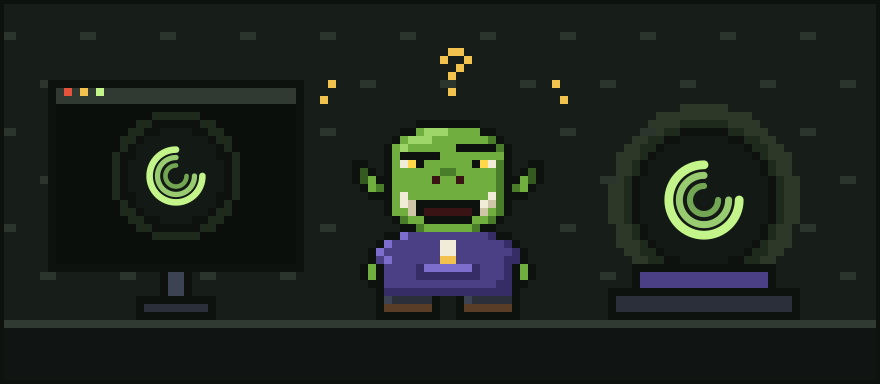

# Chapter 5: Finding the Meter

Glurp picked up the crystal ball in both hands and held it nose to glass, their single brow pressed flat against the curve.

"All right," they said. "You've been tryin' to tell me somethin'. Out with it."

The three rings slowed. Steadied. And for the first time in all the years Glurp had owned it, the ball showed them something that was not their own code.

## A sign in the glass

It was a name, glowing softly in the centre where the three rings crossed:

**Ork Meter.**

Underneath, in small and sensible letters:

*Count every token, make every token count.*

Glurp blinked. Then they did what any developer does when a magic orb recommends a product. They looked it up. They found **orkmeter.com**, made by a small workshop called **EDOS**, and the first thing they noticed was the logo in the corner: three rings turning around a bright centre.

They looked at the logo. They looked at the ball. They looked at the logo again.

"Well," said Glurp. "*That's* not a coincidence."

The lore does not say whether it was. Some things a wizard is better off not knowing.

## The counting

Glurp installed Ork Meter that night. It slipped in beside their agents without fuss, the way a good tool should, and began doing the one thing nobody had been doing. It counted. Every token in. Every token out. Which session, which task, which file, which command.

For the first time since the agents arrived, Glurp could *see*.

There was the Flood: thousands of tokens of cheerful test noise. There was the Circle: the same fix, attempted four times. There was the Forgetful Read: `config.ork`, five times, unchanged. There were the Avalanche and the Cold Hearth, laid out as plainly as footprints in snow.

It was what the crystal ball had always done for their hand-forged code, only now for the strange new world of agents. It did not scold. It simply showed them where everything went.

"Oi," said Glurp softly. "*There's* where all me tokens went."

They felt about three stone lighter.

## The healing

Seeing the wounds was one thing. Closing them was another. So Glurp tried **Ork Meter Plus**.

The workshop let them try it **free for seven days from sign-up, no card needed**. Glurp appreciated that. Orks are suspicious of anything that asks for a card before it says hello.

Ork Meter Plus, the old songs say, **heals thy wounds**. The old songs are Glurp's. They made them up in the bath.

- It **trims the Flood**, so the agent sees the failing test and not three thousand lines of happy noise.
- It **notices the Forgetful Read**, so an unchanged file is not paid for five times over.
- It **tames the Avalanche**, cutting giant output down to what matters.
- It **warns of the Cold Hearth**, so Glurp knows when resuming a big session is about to cost a fortune, *before* they do it.

As for **the Circle**, Glurp now spots it on the Meter while it is still a small loop, long before it becomes an expensive one.

None of it was flashy. All of it was useful. Dull and useful, Glurp reminded themself, is the best kind of magic.

## A new notch

That night Glurp finished a whole feature with an agent's help. Afterwards they weighed their token pouch in one hand. It was still pleasantly heavy.

They took out their carving knife and cut a new notch in the doorframe. Then, after a moment's thought, they carved a tiny three-ringed circle beside it.

On the desk, the crystal ball turned its rings slowly and contentedly. Glurp could have sworn it looked smug.

---

[Previous: The Five Wounds](04-the-five-wounds.md) · [Next: The Cousin Who Conducts the Horde](06-the-cousin-who-conducts-the-horde.md)
