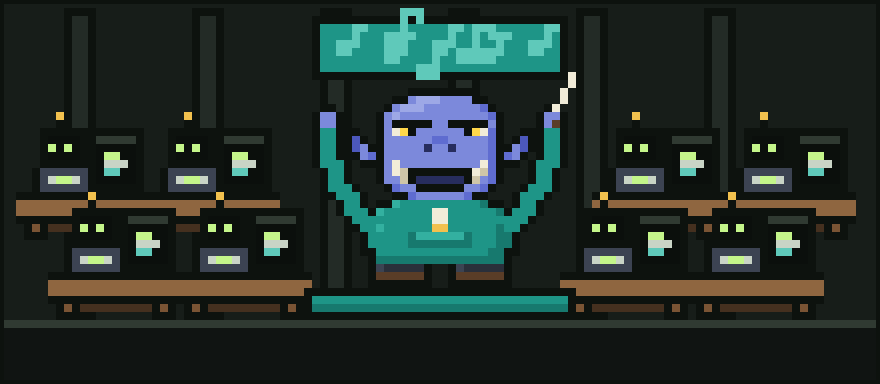
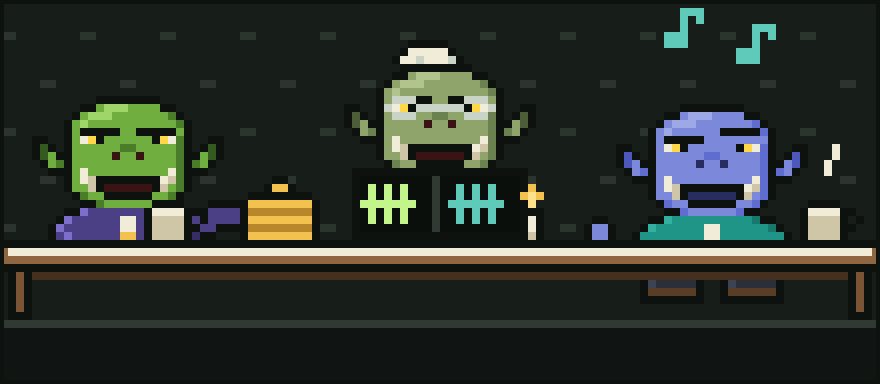
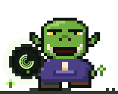

# Chapter 6: The Cousin Who Conducts the Horde

Every ork has a cousin. Glurp's cousin was **Glorp**, and Glorp was, depending on who you asked and what time of day it was, either Glurp's dearest relation or their greatest rival.

## Indigo and teal

Glorp did not look like Glurp. Where Glurp was green as a fresh prompt, Glorp had deep **indigo** skin, like the sky an hour after sunset. Where Glurp wore a purple hoodie and brown boots, Glorp wore a long coat of **teal**, with a high collar and far too many pockets, each one holding a tiny baton.

"Wand?" asked Glurp, the first time they saw the coat.

"I conduct, this is a baton!" said Glorp grandly.

## The horde

Glurp worked with one agent at a time, sometimes two, side by side at their desk like a pair of apprentices. Glorp did not work that way. Glorp worked with a **horde**.

He lived across the valley in a long hall with a great many desks, and at every desk an agent was busy: one writing code, one reviewing it, one running tests, one writing documentation nobody would read, one fixing the tests the first one broke. In the middle of it all, on a little raised platform, stood Glorp with a baton, directing the whole thing like an orchestra.

The platform he used was called **Orkestera**, made by the very same workshop, **EDOS**, that made Ork Meter. Its motto was painted over the door of Glorp's hall in tall teal letters:

**Conduct the horde.**

"One agent is a tool," Glorp liked to say. "A horde, properly conducted, is a symphony."

"A horde, *improperly* conducted," Glurp would reply, "is a very expensive racket."

## The great token argument

They had this argument at every family dinner. Grandmother Orgle had banned it twice. It went roughly like this:

**Glorp:** You fuss over every token like it's the last biscuit in the tin.

**Glurp:** It might be! You've got forty agents in that hall. Do you know how many times they've read the same file today?

**Glorp:** I'm sure it's fine.

**Glurp:** Is it, though? Have you *counted*?

There was a long silence. Glorp looked at his batons. Then, very quietly, he said: "...How would I count it?"

Glurp smiled the slow smile of a cousin who has been waiting years to win an argument at dinner.

## A truce, sort of

The next morning, Glurp walked across the valley with their crystal ball under their arm. They set it on the edge of Glorp's platform, and the two of them watched the horde work while the three rings turned.

The ball showed the same wounds Glurp had found, only bigger, because a horde makes everything bigger. Forty Floods. A dozen Circles. A Forgetful Read so persistent that one agent had opened the same README nineteen times.

Glorp's indigo face went a slightly paler indigo.

"Right," he said. "Right. Fine. Ork Meter, then. For the horde."

"For the horde," agreed Glurp, and they shook hands, green and indigo.

## How it works now

These days, Glorp conducts and Glurp counts. Orkestera keeps the horde in time; Ork Meter keeps the books. When the horde is humming along, Glorp sends a little note across the valley that says *all forty in tune, tokens under budget*, and Glurp sends back a note that says *I'll believe it when the ball shows it*.

They still argue at dinner. Grandmother Orgle has given up banning it. Now she just keeps score.

(Currently: Glurp 14, Glorp 13, one draw over whether a stack of pancakes counts as a horde.)

---

[Previous: Finding the Meter](05-finding-the-meter.md) · [Next: Glurp Joins Discord](07-glurp-joins-discord.md)
