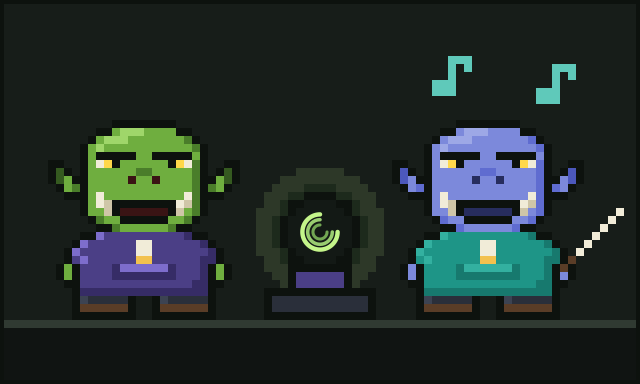

# Chapter 6: The Cousin Who Conducts the Horde

Every ork has a cousin. Glurp's was **Glorp**, and depending on who you asked and what time of day it was, Glorp was either Glurp's dearest relation or their greatest rival.

## Indigo and teal

The two looked nothing alike. Glurp was green as a fresh prompt; Glorp was deep **indigo**, like the sky an hour after sunset. Glurp wore a purple hoodie and brown boots; Glorp wore a long **teal** coat with a high collar and far too many pockets, and out of every pocket poked a slim little stick.

"Wand?" asked Glurp, the first time they saw the coat.

"I conduct, this is a baton!" said Glorp grandly.

He has never quite forgiven the question. Glurp has never quite stopped asking it.

## The horde

Glurp worked with one agent at a time, sometimes two, side by side at the desk like a pair of apprentices. Glorp worked with a **horde**.

He lived across the valley in a long hall full of desks, and at every desk an agent was busy. One wrote code. One reviewed it. One ran the tests. One wrote documentation nobody would read. One fixed the tests the first one broke. Pib had been right after all: there really was another one of 'em checking. In the middle of it all, on a little raised platform, stood Glorp with a baton, directing the lot like an orchestra.

The platform he used was called **Orkestera**, made by the same workshop, **EDOS**, that made Ork Meter. Its motto was painted over the door of the hall in tall teal letters:

**Conduct the horde.**

"One agent is a tool," Glorp liked to say. "A horde, properly conducted, is a symphony."

"A horde, *improperly* conducted," Glurp would reply, "is a very expensive racket."

## The great token argument

They had this argument at every family dinner. Grandmother Orgle had banned it twice. It went roughly like this:

**Glorp:** You fuss over every token like it's the last biscuit in the tin.

**Glurp:** It might be! You've got forty agents in that hall. Do you know how many times they've read the same file today?

**Glorp:** I'm sure it's fine.

**Glurp:** Is it, though? Have you *counted*?

There was a long silence. Glorp looked at his batons. Then, very quietly: "...How would I count it?"

Glurp smiled the slow smile of a cousin who has waited years to win an argument at dinner.

## A truce, sort of

The next morning Glurp walked across the valley with the crystal ball under one arm. They set it on the edge of Glorp's platform, and the two of them watched the horde work while the three rings turned.

The ball showed the same wounds Glurp had found at home, only bigger, because a horde makes everything bigger. Forty Floods. A dozen Circles. One Forgetful Read so devoted that a single agent had opened the same README nineteen times.

Glorp's indigo face went a slightly paler indigo.

"Right," he said. "Right. Fine. Ork Meter, then. For the horde."

"For the horde," agreed Glurp, and they shook on it, green hand in indigo.

## How it works now

These days Glorp conducts and Glurp counts. Orkestera keeps the horde in time; Ork Meter keeps the books. When the hall is humming, Glorp sends a note across the valley: *all forty in tune, tokens under budget*. Glurp sends one back: *I'll believe it when the ball shows it*.

They still argue at dinner. Grandmother Orgle has stopped banning it. Now she keeps score.

The current tally is Glurp 14, Glorp 13, and one draw over whether a stack of pancakes counts as a horde.

---

[Previous: Finding the Meter](05-finding-the-meter.md) · [Next: Glurp Joins Discord](07-glurp-joins-discord.md)
