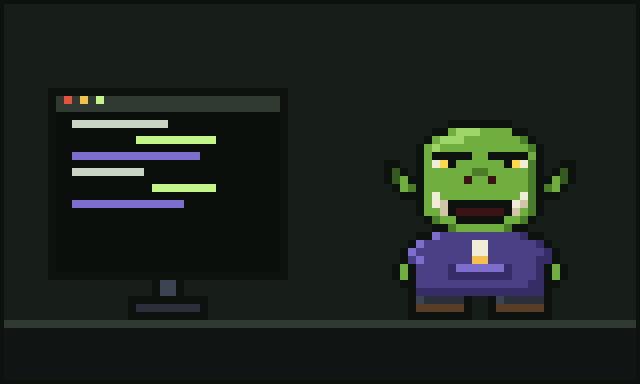

# Chapter 7: Glurp Joins Discord



For most of their life, Glurp had worked alone in the tower, with only Sir Quackington and the crystal ball for company. They liked it that way. Or they thought they did.

But the age of agents was a strange, fast, noisy age, and Glurp found out something unexpected about it: everybody else was just as lost as they were.

## The great hall of chatter

It was Pib, the young ork with the sticker-covered laptop, who dragged them in.

"There's a server," said Pib. "On Discord. Everyone who uses Ork Meter hangs out there. People share what they've found, what's eating their tokens, that sort of thing."

"I don't hang out," said Glurp. "I *work*."

"There's a bot," said Pib.

Glurp's brow rose half an inch. "What kind of bot?"

## Ork Bot

Its name was **Ork Bot**, and it lived in the server like a helpful gremlin in the rafters. You summoned it by typing `/ork`, and it answered.

Glurp's first message was cautious:

```
/ork hello
```

Ork Bot said hello back, politely, and asked what it could help with. Nobody had asked Glurp that in years, least of all a chat window. They were oddly touched.

Their second message was less cautious:

```
/ork where'd all me tokens go
```

Ork Bot, which had plainly heard that question before, pointed Glurp at their own Ork Meter numbers and walked them through where the biggest leaks were coming from. It did not lecture. It did not sell. It just helped, like a neighbour who happens to be very good with accounts. The goblin next door, by contrast, was only good with bees.

## Fellow travellers

What surprised Glurp most was not the bot. It was everyone else.

There was an elf who built websites and swore her agent had read the same stylesheet eleven times before breakfast. There was a dwarf who ran giant data jobs and had lost a whole afternoon's tokens to a single Avalanche. There was a troll, very gentle and very new to programming, whose questions were so kind and so earnest that the whole channel went out of its way to answer them.

They all had wounds. They all had stories. And every one of them, sooner or later, had asked some version of Glurp's question.

So Glurp started answering. Short things at first: "Trim yer test output, it helps." "Mind the Cold Hearth after lunch." Then longer things. Diagrams drawn badly in text. Stories from the tower.

Before long, people in the channel were saying "Oi, where'd all me tokens go?" whenever they hit a leak. Glurp could not decide whether to be embarrassed or proud. They settled on proud.

## The tower, but bigger

Glurp still works in the tower most nights. They still forge some code by hand, because they enjoy it, and because the turnip-sorting library deserves the personal touch. But now they work alongside the agents and the Meter, with a window open to the server and everyone in it.

Sometimes, very late, someone new turns up in the channel, bewildered and token-poor, and types something like *is it just me, or is this all a bit much?*

And Glurp, hood up, drawstring between their tusks, crystal ball glowing beside them, types back:

*It's not just you. Pull up a stool.*

---

[Previous: The Cousin Who Conducts the Horde](06-the-cousin-who-conducts-the-horde.md) · [Next: Epilogue](08-epilogue.md)
