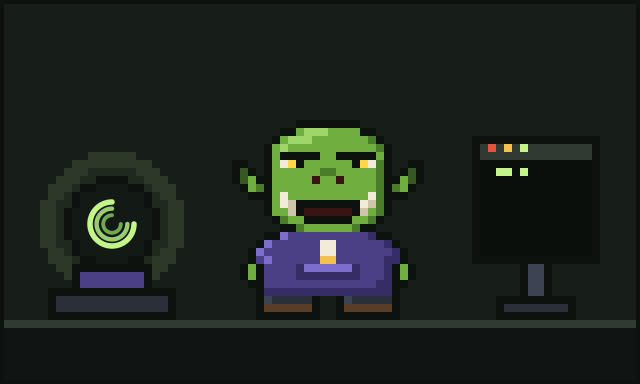

# Chapter 8: Epilogue — By the Light of the Ball

It is late in the tower. It is always late in the tower.

The rain has stopped. The kettle has boiled and been forgotten, as kettles are. Sir Quackington sits on the monitor, keeping an eye on things. The jar of **BUGS (FRIENDLY)** has one new resident, a harmless little rounding error that Glurp has decided is charming.

And Glurp is at their desk.

## What changed

If you had told the Glurp of the Age of Hand-Forged Code that one day they would write most of their features alongside tireless agents, they would have dropped their mug. If you had told them that they would spend a good part of each evening reading token counts, they would have dropped the other mug too.

But here they are. The agents read and write and test, quick as anything. They steer. They review. They hand-forge the bits that matter most to them. And on the corner of the desk, the crystal ball turns its three rings, counting everything that goes in, everything that comes out, and what it all costs.

They are not lost anymore. Not entirely. Nobody is entirely un-lost in a world that changes this fast. But they have a light to see by, and that, Glurp has decided, is enough.

## What they have learned

Glurp keeps a short list pinned above their desk. They wrote it on the back of an old invoice, in their best rhyming-couplet mood:

> Read it once, and read it right;
> trim the flood before the fight.
> If the loop goes round, then stop;
> mind the hearth, or pay the top.
> Count each token, small or grand:
> magic's best when understood by hand.

The last line does not quite scan. They know. They like it anyway.

## What comes next

Nobody knows what the next age will bring. Maybe bigger hordes. Maybe stranger agents. Maybe something that makes all of today look as quaint as hand-typed turnip-sorting libraries.

Glurp is not worried. Well, they are a little worried; they are a developer, and worrying is half the job. But they have their tools, they have their cousin across the valley (still arguing, still conducting), they have their friends in the server, and they have a ball of glass that has always, always shown them where things go.

They take a sip of cold tea. They make a face. They open a new session.

Somewhere deep in the glass, the small inner ring glows, bright and steady.

"Right then," says Glurp, cracking all eleven knuckles. "Let's see where it all goes."

*The end. For now.*

---

[Previous: Glurp Joins Discord](07-glurp-joins-discord.md) · [Back to the contents](../README.md)
