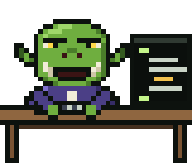

# Art placement

Where each illustration sits in the chapters. The art itself is painted by
`scripts/make_art.py`; this table says where it goes, so the pictures can be
put back after the prose is revised. Apply it with:

    python3 scripts/place_art.py          # insert any missing figures
    python3 scripts/place_art.py --check  # report anchors that no longer match

Each figure goes on its own line **after** the block that begins with the
quoted words (a paragraph, or a `##` heading). The alt text is the `<title>`
inside the SVG. If an anchor paragraph is rewritten, change the quoted words
here to the new opening and re-run.

## Placements

A figure is one Markdown image line; its title picks the placement:

    

| Placement | What it does |
| --- | --- |
| `spot-right` / `spot-left` | Floats beside the paragraphs that follow it on desktop (hanging slightly into the margin); centred between paragraphs on phones (600 px and narrower). Needs about 150 to 200 px of following text before the next `##` heading, which clears it. |
| `wide` | A framed tableau wider than the text column (up to 880 px); full panel width on phones. |
| `vignette` | A small, unframed closing ornament, centred. Use after a chapter's last paragraph. |
| *(no title)* | A full-width plate, as for each chapter's opening picture. |

The pandoc form `{.spot-right}` also works, but it shows
as literal text on GitHub, so prefer the title form.

## Chapter illustrations

The opening plate of each chapter (`images/0N-*.svg`, first line after the
heading) is unchanged and not listed.

| Chapter | Image | After the block that begins | Placement | Scene |
| --- | --- | --- | --- | --- |
| 01-the-age-of-hand-forged-code.md | images/spot-glurp-typing.svg | "Their code was not always pretty, but it" | spot-right | Glurp typing at the anvil-desk |
| 01-the-age-of-hand-forged-code.md | images/01-the-valley-queue.svg | "And Glurp would sigh, put on their reading" | wide | Valley orks queue with rock, padlock, turnips; Glurp in spectacles |
| 01-the-age-of-hand-forged-code.md | images/spot-bug-jar-and-duck.svg | "There was a pleasure in it. The click" | spot-left | BUGS (FRIENDLY) jar and Sir Quackington |
| 02-the-crystal-ball.md | images/spot-cable-box.svg | "Glurp found it at the bottom of a box" | spot-left | The ball rising from a box of old cables |
| 02-the-crystal-ball.md | images/spot-goblin-and-bees.svg | "The old orks of the valley had a word" | spot-right | The grumpy bee-keeping goblin |
| 02-the-crystal-ball.md | images/02-asleep-on-the-space-bar.svg | "The ball never spoke. But sometimes, late at" | wide | Glurp asleep on the space bar, the ball keeping watch |
| 03-the-coming-of-the-agents.md | images/03-the-tavern-rumour.svg | "Glurp's brow descended like a portcullis." | wide | Pib's sticker laptop at the tavern, Glurp's brow down |
| 03-the-coming-of-the-agents.md | images/spot-glurp-shrugs.svg | "It was wonderful. It was also bewildering." | spot-right | Glurp shrugs, bewildered |
| 03-the-coming-of-the-agents.md | images/vignette-last-token.svg | "Glurp did not notice. Not yet. They were" | vignette | The last token rolls under the desk |
| 04-the-five-wounds.md | images/04-the-five-wounds-strip.svg | "Being a careful wizard, they started a notebook." | wide | The Flood, the Circle, the Forgetful Read, the Avalanche, the Cold Hearth |
| 04-the-five-wounds.md | images/spot-glurp-reading.svg | "## Counting the cost" | spot-right | Glurp reads the Book of Wounds by candlelight |
| 04-the-five-wounds.md | images/vignette-humming-ball.svg | "This time, Glurp noticed." | vignette | The ball humming, inner ring spinning |
| 05-finding-the-meter.md | images/05-the-sign-in-the-glass.svg | "They looked at the logo. They looked at" | wide | The logo on screen, the rings in the ball, Glurp between |
| 05-finding-the-meter.md | images/spot-glurp-wand.svg | "## The healing" | spot-left | Glurp casts with a star-tipped wand |
| 05-finding-the-meter.md | images/vignette-new-notch.svg | "On the desk, the crystal ball turned its" | vignette | Glurp celebrates by the notched doorframe |
| 06-the-cousin-who-conducts-the-horde.md | images/06-the-hall-of-the-horde.svg | "He lived across the valley in a long" | wide | Glorp on the platform, baton high, agents at desks |
| 06-the-cousin-who-conducts-the-horde.md | images/06-the-family-dinner.svg | "Glurp smiled the slow smile of a cousin" | wide | Glurp points, Glorp shrugs, Grandmother Orgle keeps score |
| 06-the-cousin-who-conducts-the-horde.md | images/spot-glurp-walking.svg | "## A truce, sort of" | spot-right | Glurp walks the valley with the ball under one arm |
| 07-glurp-joins-discord.md | images/spot-ork-bot.svg | "## Ork Bot" | spot-right | Ork Bot in the rafters |
| 07-glurp-joins-discord.md | images/07-the-hall-of-chatter.svg | "There was an elf who built websites and" | wide | The elf, the dwarf, the troll, Pib and Glurp at their laptops |
| 07-glurp-joins-discord.md | images/vignette-pull-up-a-stool.svg | "*It's not just you. Pull up a stool.*" | vignette | Glurp waves a newcomer to a stool |
| 08-epilogue.md | images/spot-desk-at-night.svg | "## What changed" | spot-right | The desk at night: duck on the monitor, bug jar, cold tea |
| 08-epilogue.md | images/08-curtain-call.svg | "Glurp is not worried. Well, they are a" | wide | The whole cast together |
| 08-epilogue.md | images/vignette-the-end.svg | "*The end. For now.*" | vignette | The ball glowing, the end |

## Characters and poses

Reusable transparent sprites live in `images/poses/` (8 px cells): Glurp
celebrating, shrugging, waving, casting with a wand, reading a scroll,
walking, pointing, typing and asleep at a desk; Glorp with baton raised and
Glorp shrugging (indigo skin, teal coat, notes always above the head).
Glurp has no gender: write alt text with they/them.
